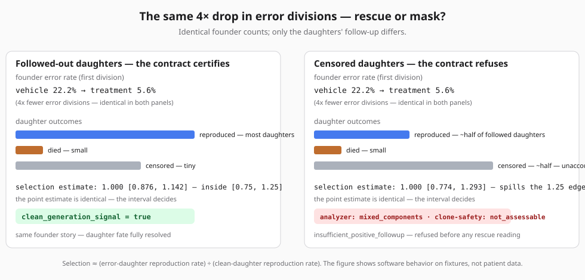

# Judge map — Track 2 (one page)

The flip, in words: two arms with identical founder-level aneuploidy drops
can hide opposite daughter truths — one is genuine error reduction, the
other is dropout of error-bearing daughters followed out less often — and
the contract only certifies the first. (If your renderer does not display
SVG, the same example is worked as text in `TRACK2_JUDGE_PACKAGE.md` §1.)

**The claim in one sentence:** a fail-closed, falsifiable decision contract
for a BUB1B-associated MVA (Mosaic Variegated Aneuploidy) rescue hypothesis
— the proposed compound-heterozygous pair is Leu737Ter + Asn1002Lys
(*phase unconfirmed: cis vs. trans unresolved*), a nonsense allele plus a
missense allele in the BUBR1 kinase-domain C-lobe hypothesized to
destabilize the protein — a folding lesion a small-molecule chaperone may
be able to stabilize (the pharmacochaperone-amenable class); exact
correction of that missense allele is the causal anchor, a ≤2 µM exposure
gate is anchored to the candidate drug's own pediatric label, and a
five-outcome first-division contract (completed-with-error, completed-clean,
died-before-completion, no-division, dropout) refuses certification whenever
cytostasis or daughter-fate selection can masquerade as rescue at the
declared floors. Arimoclomol is the single conditional probe —
exposure-gated, never a dosing claim; nothing here recommends treatment.

**The deliverable, in four rows** (full table in the report's Executive
Decision): **rank 1** — arimoclomol, conditional probe held at Gate 5 behind
an exact-allele stability defect and the ≤2 µM ceiling; **comparators** —
teprenone and sodium phenylbutyrate on the same exposure-gated rungs;
**next class** — the SIRT2/NAD+ abundance axis (honestly labeled: not an
approved medicine); **declined/disqualified** — nonsense suppression (waits
on Gate 2 transcript fate) and the HSP90-inhibitor, checkpoint-inhibitor, and
pruning classes (harm direction or selection-confound by construction). The
deliverable is a ranked disposition, not a drug answer.

**Why this is MVA-specific, not generic tooling** — the machinery is
deliberately portable, but every gate constant is disease-locked: the ≤2 µM
exposure ceiling converts the MIPLYFFA label's pediatric steady-state serum
peak (523 ng/mL ≈ 1.67 µM free base — and the label's own +1 SD tail, 717
ng/mL ≈ 2.29 µM, already exceeds the gate, so this is not a permissive
round number); the completion band is asymmetric `[0.95, 1.10]` because
lost divisions are harm in a growth-disorder child and hyper-completion is
an aneugen-risk flag; and the aminoglycoside-carryover quarantine exists
because the stop allele is a UGA opal codon — readthrough chemistry could
fake the rescue phenotype.

**Fastest path (90 s):** `python scripts/demo_contract.py` — watch the
contract refuse a rigged rescue on synthetic fixtures. No install? The
captured output is committed at `reports/TRACK2_DEMO_TRANSCRIPT.md`.

## Claims → evidence → verify → falsifier

| Claim | Evidence (committed artifact) | Verify with | This would be wrong if | min |
|---|---|---|---|---|
| The contract refuses rigged rescues (cytostasis, completion loss, selective follow-up, hyper-completion) | `reports/TRACK2_GENERATION_SELECTION_BENCHMARK.json` — 24/24 configured scenarios accepted; every required non-generation scenario inside its declared clean-signal ceiling (worst observed: the `no_change` null at 1/1,000, Wilson upper 0.56%); boundary probes are governed by declared hazard ceilings, not zero-signal requirements — two probes intentionally pass with visible residuals (see the pointer table below) | `python scripts/run_generation_selection_benchmark.py --config configs/track2-generation-selection-benchmark.json --output <new-path>` then diff against the receipt | a required scenario exceeds its declared clean-signal ceiling | 4 |
| The contract is passable, not vacuous | `reports/TRACK2_SAVE_PATH_MATRIX.json` — 126/126 configured unsafe paths blocked (100 stops / 22 holds / 4 contract-violation errors) and 1/1 constructed complete path opens | `python scripts/run_save_path_simulation.py --output <new-path>` or `python -m unittest tests.test_save_path -q` | the constructed true path fails, or an unsafe path advances | 2 |
| Results are seed-robust | `reports/TRACK2_SEED_SENSITIVITY.json` — 5/5 supplementary seeds, seed-invariant false-generation ceiling | `python scripts/run_seed_sensitivity.py --config configs/track2-seed-sensitivity.json --output <new-path>` | a supplementary seed changes a verdict | 3 |
| The bound files are exactly what was reviewed | `release/track2-reproducibility.json` binds the artifact set (role → path → sha256); `release/release-artifacts.json` binds the report, pitch, track-1 surfaces | `python scripts/verify_track2_reproducibility.py .` → `GO` (full clone) or `GO-DIGESTS-ONLY` (ZIP) | any digest mismatches | 1 |
| The release is signed and externally timestamped | `attestation/release-signature.asc` + `attestation/timestamp-proof.json` (FreeTSA RFC 3161) | `python scripts/verify_release_signature.py .` → `SIGNATURE OK`; `attestation/VERIFY.md` §§2–3 | signature fails or the timestamp imprint mismatches the manifest digest | 1 |
| No participant data leaked — including into Git history | `scripts/privacy_gate.py` scans working tree, index, and every reachable historical blob under transformed views (rot13, reversed, unescaped, compacted); `attestation/privacy-review.md` records the review | `python scripts/privacy_gate.py .` → `GO` | any identifier, HGVS call, accession, or payload surfaces in tree, index, or history | 45–90 |
| Docs' commands actually resolve | `scripts/check_docs.py` lints every `python scripts/…` reference and internal link across the markdown corpus | `python scripts/check_docs.py .` | any referenced script or link is dead | 1 |
| Composite release readiness | the submission GO gate (worktree, manifests, signature, timestamp, disclosures, attestations) | `python scripts/check_submission_go.py` → `overall: GO` | any single check fails closed | 1 |

**Receipt pointers for headline numbers** — in
`reports/TRACK2_GENERATION_SELECTION_BENCHMARK.json`, each scenario object
carries `clean_generation_signal` (`successes`/`total` plus `wilson_upper`)
against its declared `clean_signal_wilson_upper_bound` ceiling:

| Scenario | Clean signals | Wilson bound | Declared bound |
|---|---|---|---|
| `no_change` (true null) | 1/1,000 | upper 0.56% | ≤1% |
| `masked_followup_rescue` | 1/1,000 | upper 0.56% | ≤40% |
| `completion_band_edge_rescue` | 1/1,000 | upper 0.56% | ≤2% |
| `subthreshold_rescue_small_sensitivity_drift` | 209/1,000 | upper 23.5% | ≤30% (boundary probe) |
| `audit_band_edge_drift` | 177/1,000 | upper 20.2% | ≤50% (boundary probe) |
| `fewer_new_errors_strong` (true rescue — the power scenario) | 374/1,000 clean | lower 34.5% | ≥25% declared floor (generation-flagged in 90.5% of runs) |

**One command for the fast subset:** `python scripts/verify_all.py .`
(manifest + signature + timestamp). The deeper gates —
`privacy_gate.py` (tree, index, reachable history) and
`check_submission_go.py` — run separately and are not part of that fast
path.

**Prerequisites:** Python 3.12+, `git` (for ancestry/cleanliness checks;
digests verify without them).

## Weakest points, stated honestly

- **No wet-lab data exists.** Every receipt certifies software behavior on
  synthetic fixtures; none is biological evidence. The package's claim is the
  contract, not a result.
- **Prime editing has never been published in a checkpoint-defective line**;
  clone recovery and TP53 outcomes are budgeted empirically, not assumed.
- **The benchmark is a configured toy** — it certifies recoverability for its
  declared effect sizes and artifact scenarios, not real-data power, imaging
  accuracy, or biological correctness.
- **Detection and certification are different layers, honestly separated.**
  The strong-rescue scenario trips the generation flag in 90.5% of runs but
  certifies clean in only 37.4% (against a declared ≥25% floor) — the
  certificate demands flag plus completion-equivalence plus
  selection-equivalence at once, so most detected rescues still stop short
  of certification by design.
- **One infra caveat:** the composite checker's embedded privacy scan carries
  a bounded internal timeout that a full-history scan can exceed on a slow
  machine; `privacy_gate.py` run standalone (uncapped, same checks) is the
  authoritative surface and passes GO.
- **Reconstruction honesty:** this tree was rebuilt after a local disk loss
  from the last published state plus retained receipts; anything the rebuild
  could not reproduce was dropped rather than approximated, and the method
  log records the event.

## Reading order after this page

1. `reports/TRACK2_JUDGE_PACKAGE.md` — worked example ("the flip"),
   precedent table, gate chain, threat model.
2. `reports/josephmayo_track2_report.md` — Executive Decision's ranked
   dispositions + first-experiment card, then §1 (observed/inferred/unknown)
   → §4 (generation-vs-selection estimands) → §6 (falsification table).
3. `reports/TRACK2_DEMO_TRANSCRIPT.md` — the 16-scenario refusal demo,
   captured for reading without running.
4. `reports/TRACK2_PORTABILITY.md` — what the contract machinery ports to
   other disease classes and what must be rebuilt.
5. `reports/TRACK2_EXTERNAL_CASE_REPLAY.md` — a published real-world false
   rescue refused by two independent layers.
