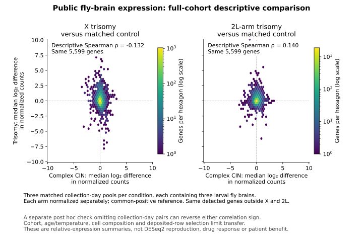

# Preserving useful neural capacity

## Phenylbutyrate and ursodeoxycholic acid: separate therapeutic hypotheses for BUB1B-associated MVA

Joseph Mayo — Track 2, Rare Disease, Real Kid: MVA Hackathon 2026

Research case, 24 October 2026. **No new wet experiment, BUB1B neural drug rescue or clinical benefit has been demonstrated by this project.**

### The therapeutic proposal

We nominate two approved medicines as **separate conditional research candidates** for usable function in surviving neural cells. **Phenylbutyrate (PBA)** could reduce ongoing protein-quality injury if that injury is a reversible cause of dysfunction. **Ursodeoxycholic acid (UDCA/ursodiol)** could preserve useful output downstream of incomplete protein disposal if an ongoing energetic/redox-associated limitation is reversible. Neither lesion has been established in BUB1B neural tissue or this child. Their actions are pleiotropic; these hypotheses are distinguishable, not proven mutually exclusive.

PBA retains the closer human aneuploid-neuron drug precedent. UDCA adds actual genetic-model functional protection despite persistent disposal abnormalities and tentative human brain pharmacodynamics. Neither has demonstrated BUB1B neural rescue, a sufficient human free-neuronal exposure or clinical benefit. This is not a combination proposal or a clinical ranking.

The intended benefit is neural capacity retained or recovered while preserving maturation, precursor reserve and chromosome surveillance. More surviving cells or lower stress markers alone do not establish it. Neither drug is shown to replace earlier developmental losses or correct abnormal karyotypes. Whether a **recoverable functional deficit in viable tissue** exists is the central uncertainty.

### 1. What could still be recoverable?

BUB1B encodes BUBR1, which supports the spindle checkpoint and correct chromosome attachments. **The working mechanism is reduced checkpoint and attachment function (loss of function), with residual activity unresolved.** The public entry proposes L737Ter/N1002K; phase and endogenous transcript/product behavior have not been independently established here. The stop could cause transcript decay or truncation. N1002K could affect stability, intrinsic function or both. The linked ClinVar missense record concerns a different nucleotide substitution producing the same protein change, so it does not independently confirm the child's allele. [Public entry](https://github.com/josepha-mayo/mva-hackathon-entry), [stop record](https://www.ncbi.nlm.nih.gov/clinvar/variation/533901/), [missense record](https://www.ncbi.nlm.nih.gov/clinvar/variation/4600147/).

Direct BUBR1 evidence is an important challenge to a survival-centered story. Adult BubR1-low hippocampus showed impaired progenitor production and neuronal maturation without a detected newborn-cell survival difference. Other models show cortical progenitor depletion or impaired oligodendrocyte production/myelination. An ongoing protein-quality lesion therefore cannot be presumed to explain every BUBR1 phenotype. No progressive decline, ataxia or myelin lesion is assumed in this child. [Adult neurogenesis](https://pmc.ncbi.nlm.nih.gov/articles/PMC5418205/), [cortical study](https://pmc.ncbi.nlm.nih.gov/articles/PMC6522074/), [myelination study](https://pmc.ncbi.nlm.nih.gov/articles/PMC5191862/).

A 2026 complex chromosome-instability fly model nevertheless provides causal evidence that downstream consequences can be modified. Genetic mitochondrial-chaperone or redox enhancement restored progeny-cell counts and brain size. Rapamycin increased neuroblast counts while measured brain-lobe area decreased; its effect on Pros-positive progeny was not reported in that comparison. Genetic autophagy enhancement did not restore progeny counts or brain size. These are developmental genetic and cell-count findings, not PBA treatment or behavioral recovery. They motivate the downstream route while showing why precursor abundance, progeny abundance and useful function must remain distinct. [Primary study, Figures 6–7 and Supplementary Figure 6C](https://doi.org/10.1038/s41467-026-70521-0).

Direct BUBR1-deficient cortex adds a safeguard: Trp53 co-deletion reduced apoptosis and improved selected early populations and dimensions, while DNA damage persisted and cortical thickness at postnatal day 21 was not significantly restored. This partial developmental rescue does not test either drug or show that UDCA reproduces p53 deletion. It explains why survival must be assessed with maturation, durable output and genomic consequences. [Sterling, Figures 3 and 7–8](https://pmc.ncbi.nlm.nih.gov/articles/PMC10602889/).

### 2. PBA: the closer aneuploid-cell anchor, with opposing results

**Closest human aneuploid evidence.** Hirata's trisomy-13/21 neural cultures received nominal 100 micromolar PBA from neural induction. Figure 5 includes actual drug-versus-vehicle ER-marker comparisons; not every baseline or drug contrast is significant. Figure 6 shows reduced aggregates and cleaved-caspase-3 signals. These establish selected stress/death-associated changes, without durable useful neural output or delayed rescue of mature neurons. In a 2026 study's Figure 8i–j co-culture comparison, PBA reduced aggregate/caspase signals in trisomic neurons cultured with DYRK1A-corrected astrocytes. Those panels lack a PBA-plus-uncorrected-astrocyte arm, so they cannot establish synergy. [Hirata, Figures 5–6](https://doi.org/10.1038/s41598-020-70362-x), [Nambara, Figure 8i–j](https://pmc.ncbi.nlm.nih.gov/articles/PMC13179340/).

**Actual oral neural function.** In CNS-specific Derlin-1-deficient mice, oral PBA beginning early in development reduced mean beam falls at approximately 13 weeks; mutant groups were n=7, with p<.0001 and p<.01 for thick/thin beams. Completing every trial without falling was not significant after Holm correction: 0/7 to 5/7, p=.084, and 0/7 to 3/7, p=.385. Oral cerebellar cholesterol was also nonsignificant, p=.119. Separate injected experiments failed to reduce ER-stress markers; they do not establish the mediator of the oral behavioral response. This is functional evidence in an ER-quality-control disorder, without measured free brain exposure. [Sugiyama 2022, Figure 4 and Supplementary Figure S4](https://pmc.ncbi.nlm.nih.gov/articles/PMC9759528/).

Oral PBA improved Barnes-maze performance in 5XFAD mice, n=5–6/group. The paper's brain HPLC measures **phenylacetate (PAA)**, not parent PBA. This supports an oral-drug functional response, but cannot establish parent-drug chemical-chaperone exposure or its mediation. [Corbett, Figures 7a and 9](https://pmc.ncbi.nlm.nih.gov/articles/PMC3605648/).

Related Tg2576 studies reported PBA-associated improvement in spatial learning/memory and reinstated fear learning, including 12–16-month-old animals with established model pathology. These are late-stage functional precedents, although they do not establish an individually documented pretreatment deficit, reversal of earlier developmental loss or chemical-chaperone mediation. The checked primary abstracts do not support adding an effect size or oral-route claim; these related studies are not automatically independent replication. [Ricobaraza 2009](https://doi.org/10.1038/npp.2008.229), [Ricobaraza, online 2010/issue 2012](https://doi.org/10.1002/hipo.20883).

**Function can improve selectively, or remain impaired despite marker relief.** PBA improved stimulus-dependent vesicle-cycling measurements in mutant Munc18-1 neurons; those experiments cannot inherit the trisomy study's concentration. In a different GABA-receptor disorder, PBA improved inhibitory-current amplitude, with separate injected-mouse seizure/behavioral positives. Conversely, earlier Derlin experiments lowered stress markers without rescuing shortened dendrites, and the 2026 GABRA1 study's protein-expression gains accompanied nonsignificant measured current changes. Severe-loss STXBP1 zebrafish showed no motor or seizure benefit under the tested conditions. No result establishes BUB1B drug responsiveness. [Munc18-1, Figures 6–7](https://doi.org/10.1038/s41467-018-06507-4), [GABRG2](https://pmc.ncbi.nlm.nih.gov/articles/PMC10842976/), [Derlin, Figure 4D–G](https://pmc.ncbi.nlm.nih.gov/articles/PMC8324814/), [GABRA1, Figure 3](https://pmc.ncbi.nlm.nih.gov/articles/PMC13465587/), [zebrafish negative](https://doi.org/10.1002/prp2.70285).

The GABRG2 neuron experiment used nominal 2 mM PBA: miniature-current amplitude rose from 19.19 to 30.70 pA, while frequency did not improve. This is stronger evidence of a drug-responsive neural function than protein abundance alone, but its millimolar exposure is not validated by the 100-micromolar trisomy result or human plasma measurements. [GABRG2, Figures 1–2](https://pmc.ncbi.nlm.nih.gov/articles/PMC10842976/).

A 2026 **preprint** adds oral neuronal physiology with a simultaneous negative. After 28-day oral PBA, heterozygous Slc6a1-S295L mouse spontaneous inhibitory-current decay shortened to a median 3.1 versus 5.1 ms untreated, while evoked-current decay remained prolonged (63.2 versus 59.0 ms). Seven-day injected treatment improved uptake but neither current-decay endpoint. These are selective physiological responses, not established useful network recovery or BUB1B rescue. No free-brain exposure was supplied; this is the same research lineage as earlier SLC6A1 work. [Zavalin, Figure 3 and Extended Data 5; preprint status rechecked](https://doi.org/10.64898/2026.01.20.700615).

**A direct maturation counterexample.** In a v-myc-immortalized human embryonic midbrain precursor line, nominal 0.5 mM PBA for five days suppressed differentiation markers and process development while retaining precursor markers. This challenges general pro-maturation language. It is neither a normal primary BUB1B preparation nor a clinically matched toxicity experiment; comparing its nominal concentration with another culture does not define a therapeutic window. [Khan, Figures 1–2](https://www.spandidos-publications.com/10.3892/ijmm.2011.791/download).

**Human benefit remains uncertain.** The placebo-controlled 107-child SMA trial found no motor advantage for its tested regimen: Hammersmith improvement 0.60 versus 0.73, p=.70. Small uncontrolled neurological reports describe seizure and developmental gains alongside sedation, metabolic acidosis and adverse-effect discontinuations. Concomitant treatments and unresolved participant overlap prevent pooling them into a response rate. In two older MCT8-deficient twins, peripheral biochemical improvement accompanied small motor changes and high-exposure tolerability problems. These findings neither demonstrate MVA benefit nor make one disease's negative result a universal PBA failure. [SMA trial](https://pubmed.ncbi.nlm.nih.gov/17082463/), [pediatric observational report](https://pmc.ncbi.nlm.nih.gov/articles/PMC13405358/), [MCT8, Tables 4–6](https://academic.oup.com/jcem/article/109/10/2589/7625621).

The MCT8 report cannot establish toxicity at ordinary approved exposure or show that earlier intervention would fail. A separate randomized 95-adult study of PBA plus taurursodiol found no significant clinical-composite benefit despite favorable changes in some CSF markers. The combination cannot isolate PBA, but demonstrates why human biomarker improvement is insufficient. [PEGASUS, Table 2 and Figure 2](https://pmc.ncbi.nlm.nih.gov/articles/PMC11310855/).

**Separate residual-BUBR1 opportunity.** Expression-matched I909T/L1012P constructs restored checkpoint response in depleted U2OS cells. These results support recoverability for particular mutants, not a universal abundance threshold or N1002K rescue by PBA. The C-terminal domain also supports KARD phosphorylation and PP2A-B56 recruitment; more protein need not restore its required functions. [Suijkerbuijk, Figure 4](https://doi.org/10.1158/0008-5472.CAN-09-4319), [C-terminal mechanism](https://doi.org/10.1016/j.celrep.2020.108397).

### 3. Delivery and long-term benefit–risk for PBA

Human oral CNS evidence exists but is narrow. A two-adult adrenoleukodystrophy conference report assigned an MRS signal to PBA. One patient had estimated 0.25±0.10 mM in demyelinated white matter and 0.57±0.20 mM in ventricular CSF; normal-appearing white matter and the second patient lacked definitive signals. The retrieved abstract supplies no numerical detection limit or validated separation from phenyl-containing metabolites. This is a regional estimate, not free interstitial parent exposure; nondetection does not establish zero. [Barker, abstract 1135, Figures 1–2](https://cds.ismrm.org/ismrm-2000/PDF4/1135.pdf).

Glycerol-PBA is a prodrug; parent PBA, PAA and intact prodrug are different analytes. Total-plasma AUC resembling nominal culture concentration multiplied by time cannot establish a neuronal exposure window. Binding, route, concentration–time profile and formulation matter; detailed arithmetic remains in the [exposure appendix](https://github.com/josepha-mayo/mva-hackathon-entry/blob/main/docs/exposure_time_audit.md). Transient exposure could trigger persistent pharmacodynamics, so continuous exposure is not assumed necessary. No validated oral-human free neural exposure–response relationship for the nominated function was established.

Approved UCD use does not establish the benefit–risk balance for long-term MVA treatment. The GPB label reports rat tumors at elevated combined PBA/PAA exposure, alongside negative standard genotoxicity and a shorter transgenic-mouse study. FDA's original reviewer presumed potential tumor risk could be shared by sodium PBA because metabolic profiles are similar, while accepting the risk for life-threatening UCD. The experiment used GPB; shared risk is an inference, and human MVA cancer risk is unquantified. Sodium formulation cannot simply be declared an escape from that uncertainty. [Label, §13.1](https://dailymed.nlm.nih.gov/dailymed/drugInfo.cfm?setid=900e7dc0-9afe-4f50-80de-90567bb78519), [FDA review, printed pp. 216–217](https://www.accessdata.fda.gov/drugsatfda_docs/nda/2013/203284Orig1s000PharmR.pdf).

No located actual-PBA experiment establishes impaired immune clearance or worsened chromosome instability in relevant BUB1B cells at clinical free exposure. These are unresolved concerns, not demonstrated harms. Preserving useful postmitotic neurons and preserving abnormal proliferative clones require separate judgments.

The rat combined-exposure multiples do not define a human cancer threshold. The reviewer's historical absence of an identified Buphenyl cancer risk is not a current MVA safety estimate. [Label, §13.1](https://dailymed.nlm.nih.gov/dailymed/drugInfo.cfm?setid=900e7dc0-9afe-4f50-80de-90567bb78519), [FDA review, printed p. 217](https://www.accessdata.fda.gov/drugsatfda_docs/nda/2013/203284Orig1s000PharmR.pdf).

### 4. UDCA: useful output despite incomplete disposal repair

**Actual genetic-model function.** In CHMP2B-Intron5 models, UDCA partly improved fly crawling and protected rat-neuron dendrites, spines and survival. Abnormal endosomes, LC3 accumulation and ubiquitinated inclusions persisted. GCLC expression rose and genetic overexpression reproduced selected benefits; a necessary drug mediator was not established. These results support functional protection downstream of disposal failure, not proven mitochondrial repair or BUB1B portability. Nominal conditions were 600 micromolar in fly food for crawling and 10 micromolar for rat neurons. Treatment began during development or immediately after transfection; this is not demonstrated reversal after a documented deficit. [West 2020, Figures 1–6 and Methods](https://doi.org/10.1016/j.nbd.2020.105047).

UDCA also partly preserved evoked visual responses in LRRK2-G2019S flies. Treatment began at adult emergence, before the later deficit was documented. A separate low-concentration fibroblast ATP result is not a neuronal functional threshold. A 2026 mouse-stroke positive began treatment four days before injury. These strengthen a protection hypothesis while leaving delayed recovery unresolved. [Mortiboys, Figure 5 and Methods](https://pmc.ncbi.nlm.nih.gov/articles/PMC4560055/), [Liu 2026](https://pmc.ncbi.nlm.nih.gov/articles/PMC13273212/).

A functional negative also exists: in bile-duct-ligated mice, UDCA begun either before surgery or three days afterward did not significantly improve day-10 Y-maze short-term memory. This is a cholestasis model, not BUB1B disease; post-surgery treatment did not follow an individually documented memory deficit. The hippocampal-network recordings compared sham, injured and obeticholic-acid groups, without a UDCA arm, so they cannot be called a direct UDCA network negative. [Gee, Figures 1C and 4](https://doi.org/10.1016/j.ajpath.2022.09.005).

**Human brain pharmacodynamics, with a clinical negative.** In a 48-week Parkinson trial, 31 adults were randomized and 30 completed. Paired phosphorus-MRS included 25, with 24 contributing the calculated ATP-hydrolysis free-energy estimate. Exploratory, multiplicity-uncorrected analyses favored UDCA for that regional estimate and normalized inorganic phosphate. These are not measured ATP-production flux or neuron-specific usable energy. An 18-person gait subset had a favorable cadence change; broader MDS-UPDRS-III OFF did not show benefit: difference +3.52 points, 95% CI −1.83 to 8.86. Primary outcome was safety; the trial could neither establish nor exclude neuroprotection. [Payne 2023, Figures 1/3 and Methods](https://doi.org/10.1002/mds.29450).

The primary thesis records normalization/reference assumptions and sensitivity of some MRS changes to a few participants; it is the same cohort, not replication. An earlier three-person MRS subset did measure reaction kinetics: ATP concentration rose slightly, but ATPase reaction rates fell in the first two participants. The two studies cannot be combined as replicated increased ATP production. A 2026 observational study concerns incident PD in adult patient-trials, not necessarily unique people, and contains inconsistent risk-difference intervals; it does not establish recovery or MVA efficacy. [Payne thesis, pp.114–117,136–137](https://etheses.whiterose.ac.uk/id/eprint/31442/), [Sathe](https://pmc.ncbi.nlm.nih.gov/articles/PMC7245554/), [Ju 2026](https://doi.org/10.1002/mds.70535).

**Exposure is a missing bridge.** Standard-tablet ALS observations reported CSF UDCA of approximately 43–282 nanomolar. A different solubilized formulation reported 0.75–1.72 micromolar in seven people, with raw data not shown. Neither equals continuous 10-micromolar free-neuronal drug. That CHMP2B test condition is not a universal minimum effective concentration. UDCA and tauroursodeoxycholic acid/TUDCA are different molecules; TUDCA results and PBA–TUDCA combination outcomes cannot substitute for UDCA monotherapy. [Parry](https://pubmed.ncbi.nlm.nih.gov/19935406/), [Min](https://pmc.ncbi.nlm.nih.gov/articles/PMC3271295/).

**A lower-concentration tissue-protection precedent.** In a retinal-detachment pilot, oral UDCA was detected in ocular fluid in 12/21 treated adults; entry correlated with barrier disruption. Rat retinal explants at nominal 10 and 50 ng/mL had less LDH release; 10 ng/mL preserved photoreceptor structure. At 500 ng/mL, LDH/caspase benefits were absent despite other marker changes. Selected pooled patient fluids also reduced explant injury signals, without independent patient-level replication. This strengthens oral-accessible cytoprotection plausibility, but establishes neither useful visual function nor free drug exposure in intact brain. Visual improvement did not significantly correlate with drug levels in this underpowered pilot. [Daruich 2021, Figures 1–4 and Supplementary Figure 2](https://pmc.ncbi.nlm.nih.gov/articles/PMC8423962/).

In the solubilized-formulation ALS crossover trial, only 16 of 63 participants completed both periods. A favorable AALSRS analysis accompanied nonsignificant ALSFRS-R and FVC results. Attrition, completer analysis and the distinct formulation prevent treating this as established efficacy. The 63-participant denominator is separate from the seven-person CSF observation. [Min 2012](https://pmc.ncbi.nlm.nih.gov/articles/PMC3271295/).

**Pediatric experience exists; MVA safety remains unresolved.** UK Ursofalk suspension is licensed for CF-associated hepatobiliary disease from one month to 18 years; US tablet pediatric limitations cannot be generalized worldwide. This is liver-use feasibility, not pediatric CNS efficacy. A high-exposure PSC/ulcerative-colitis subgroup had more colorectal neoplasia, and a retrospective neonatal Down-syndrome cholestasis series associated UDCA with poorer outcomes. Neither resolves causal MVA risk. US labeling includes a female-rat adrenal tumor signal alongside negative studies. Standard mutagenicity findings and small PD-trial tolerability do not establish chromosome fidelity or long-term safety in this child. [UK SmPC](https://www.medicines.org.uk/emc/product/146/smpc), [Eaton](https://pmc.ncbi.nlm.nih.gov/articles/PMC3168684/), [Kotb, Table 3](https://pmc.ncbi.nlm.nih.gov/articles/PMC6815214/), [US label](https://dailymed.nlm.nih.gov/dailymed/drugInfo.cfm?setid=1a3a8942-94d4-4292-bf74-0a67d92acb90).

### 5. What would establish the intended benefit?

Either primary claim requires **actual drug improvement in a relevant useful neural output at measured, realistic exposure**, with survival, maturation, total output and function per survivor distinguished. A delayed intervention tests recovery; earlier exposure tests prevention. Neither marker relief, more neurons nor increased spontaneous activity alone establishes useful function. PBA and UDCA should face the same functional question without assigning a favorable response in advance. An informative functional negative or maturation harm at qualified exposure would materially weaken the corresponding nomination.

This distinction preserves the patient-benefit intent. A surviving cell that fails to mature or communicate may add little useful capacity. Conversely, improved output from existing viable cells could matter even if chromosome imbalance persists and cell numbers do not rise. Checkpoint correction is neither demonstrated nor required by that bounded downstream claim.

A suitable disease-relevant neural preparation and reference are prerequisites, not resources claimed to be available. No publicly listed assay-ready BUB1B neural/corrective-reference pair was verified in the bounded search. A blood-cell result cannot resolve neural benefit. [Neural comparison](https://github.com/josepha-mayo/mva-hackathon-entry/blob/main/docs/neural_protection_comparison.md).

The MVA Society reports an MVA worm drug-repurposing programme, patient single-cell profiling and family-derived fibroblast work. These are potential follow-up routes, subject to the research programme's scientific assessment and access confirmation. The public page does not identify the worm gene/allele, assay or drug-response results; no relevant model or material access is established for this project. The linked published UNC80 screen demonstrates a screening method in another genotype, not MVA drug rescue. This existing-programme lead was retained from our earlier audited work and rechecked today. [Official programmes](https://mvasociety.org/our-research-projects/), [UNC80 primary screen](https://doi.org/10.7554/eLife.92491.4).

For the secondary cycling route, productive division, chromosome-error components, death and nondivision distinguish **viable progeny under the assay definition** from cytostasis or selective loss. They cannot establish postmitotic neural communication, euploid daughters or long-term clone safety. A cycling negative alone does not retire the neural route; any BUBR1-supply attribution requires independent causal evidence. Coriell GM21284 is an EBV-transformed B-cell resource with S738fsX753/R814H, not a native L737Ter readthrough model; availability and competence remain unconfirmed. [Finite pilot](https://github.com/josepha-mayo/mva-hackathon-entry/blob/main/docs/finite_pilot.md), [official resource](https://catalog.coriell.org/0/Sections/Search/Sample_Detail.aspx?Product=CC&Ref=GM21284).

### 6. Alternatives that could change the priority

**Fluoxetine** is a production/plasticity challenger: genetic sFRP3 reduction improves selected BubR1-mouse measures, while actual fluoxetine has separate functional precedents. The genetic rescue is not a fluoxetine result. Rodent sFRP3 directions differ, another drug study inhibited oligodendrocyte differentiation, and the small 2026 pediatric trisomy-21 study lacked placebo and multiplicity control. A demonstrated production/plasticity limitation could change the choice. [BubR1/sFRP3](https://pmc.ncbi.nlm.nih.gov/articles/PMC6413750/), [rat target direction](https://pmc.ncbi.nlm.nih.gov/articles/PMC2929274/), [oligodendrocytes](https://pmc.ncbi.nlm.nih.gov/articles/PMC11306862/), [human exploratory study](https://doi.org/10.1177/10445463261458603).

**NAC** offers a credible redox alternative with substrate-linked glutathione pharmacodynamics and human oral CSF observations. A cysteine-responsive BUB1B deficit remains unestablished; checkpoint-depleted fly behavioral rescue used distinct NACA. **Elamipretide** requires a responsive mitochondrial lesion; MMPOWER-3 found no walking advantage in 218 participants. Neither absence of a demonstrated lesion nor that trial establishes universal failure. [NAC PK/PD](https://pmc.ncbi.nlm.nih.gov/articles/PMC4720670/), [NACA](https://pmc.ncbi.nlm.nih.gov/articles/PMC11062972/), [MMPOWER-3](https://pmc.ncbi.nlm.nih.gov/articles/PMC10382259/).

**Levacetylleucine** has controlled human symptomatic evidence and current US approval for A–T ataxia at weight ≥15 kg. It could deserve priority for a corresponding documented symptom. Neither ataxia nor applicable weight can be assumed here; approval in another genome-instability disorder does not establish BUB1B disease modification. [FDA indication and 73-participant trial](https://www.fda.gov/drugs/news-events-human-drugs/fda-approves-therapy-treat-ataxia-patients-ataxia-telangiectasia-rare-genetic-disorder).

The broader research record preserves competing mechanisms and rejected leads. Shared targets, genetic rescue and investigational-drug responses do not establish the nominated medicine's functional effect. [Comparative evidence](https://github.com/josepha-mayo/mva-hackathon-entry/blob/main/docs/drug_decision.md).

### 7. Executed analyses and their limits

We challenged transfer from simple trisomy to complex chromosome instability using public fly-brain counts. With the same **5,599** nuclear genes outside X/2L, the specified chromosome-reference normalization and matched-pool median log2 effects, descriptive Spearman correlations were **−0.132 for CIN–X and +0.140 for CIN–2L**. Signs persisted across declared computational normalizations/thresholds. However, a separate **post hoc** check omitting collection-day pairs with full-data factors and genes held fixed could reverse either sign. Independent recomputation reproduced the estimates. These are descriptive sensitivities, not confidence intervals or drug responses. Biological replication is three pooled-brain collection days per condition. [CIN GEO](https://www.ncbi.nlm.nih.gov/geo/query/acc.cgi?acc=GSE290206), [trisomy GEO](https://www.ncbi.nlm.nih.gov/geo/query/acc.cgi?acc=GSE301548).

Figure: dependent gene features in density bins, not biological replicates. Relative expression does not measure drug response.

Age, temperature, perturbation and bulk composition differ between cohorts; deposited-row selection remains unresolved. Our estimator differs from the paper's shrunken DESeq2 comparison, so a differing sign is not a refutation. The capsule preserves original/corrected runs, full methods and the post hoc diagnostic. These summaries do not establish reliable trisomy-to-CIN transfer, PBA efficacy or failure.

A precise source-sheet conflict also limits automated interpretation. Supplementary Data 1 assigns Hsp70Bb to FBgn0013278 in stricter sheet “P VALUE 0.01, FC~1.5 ” row 8, but FBgn0260475 in broader sheet “P VALUE 0.05, FC 1.25” row 6, with identical adjusted-P and fold-change values. FlyBase identifies those IDs as Hsp70Bb/3R and CG30059/2R, respectively. Across 61 shared symbols, 27 IDs conflict. The broader sheet cannot safely supply those ID joins; cause and implications elsewhere remain unknown. This does not invalidate the paper's biology or establish incorrect GEO counts. [Article/supplements](https://doi.org/10.1038/s41467-026-70521-0), [Hsp70Bb](https://flybase.org/reports/FBgn0013278), [CG30059](https://flybase.org/reports/FBgn0260475).

The published capsule runs the processed-count analysis with CPU Python, fixed input hashes and a frozen annotation projection. Shared-gene comparisons, explicit pool sensitivity and auditable source joins are reusable analytical steps. Every new cohort still requires suitable annotation, reference qualification and independent biological replication; these calculations do not supply missing therapeutic validation.

Earlier Aurora and synaptic-workbook audits reproduced source measurements while exposing summary-label and missing-replication limits. They remain separate from new experiments or drug-rescue evidence. The contribution is a concrete, revisable medicine hypothesis: **PBA may reduce reversible protein-quality injury; UDCA may preserve output downstream of incomplete disposal.** Neither route has a demonstrated BUB1B exposure–function bridge. [Aurora audit](https://github.com/josepha-mayo/mva-hackathon-entry/blob/main/docs/aurora_source_data.md), [synaptic audit](https://github.com/josepha-mayo/mva-hackathon-entry/blob/main/docs/nall_source_data_audit.md).

### Methods disclosure and acknowledgement

**AI methods:** OpenAI ChatGPT/Codex on ChatGPT Pro assisted public-source research, scientific challenge, code, calculations, writing and media assembly. The operator confirmed “Improve the model for everyone” is Off. Earlier work used user-requested GPT-6 Astra at max and GPT-6.1 Sol at max/high; final-day independent challenges used fresh GPT-6 Astra/max agents, followed by a focused GPT-6.1 Sol/high transfer review. Initial briefs withheld parent rankings, but supplied global memory exposed some earlier candidate names, so these were not strictly blinded reviews. A later focused Sol/high review independently checked the retinal-exposure paper. These are recorded configurations, not per-response provider attestations. No controlled participant payload was downloaded or processed in this extension.

The preserved baseline separately records Cursor Ultra/Grok 4.6 with operator-reported privacy mode; Codex ChatGPT Pro/GPT-5.6 Sol with training disabled as operator-verified at freeze; and Devin Core/ACU/SWE-2 Max with operator-confirmed no-training terms at freeze. Those historical disclosures were not freshly reverified. AI output is not biological evidence.

**Dataset reference:** [Rare Disease, Real Kid: MVA Hackathon 2026 controlled dataset](https://huggingface.co/datasets/SageBio/mva-hackathon-2026-data), [organizer Synapse page](https://www.synapse.org/Synapse:syn76251147/wiki/642892), public reference pages accessed 22 October 2026. No controlled dataset was downloaded for this extension. Official rules and submission instructions were rechecked 24 October 2026. No patient/family contact, material acquisition or wet experiment occurred.

**Reproducibility:** the [public CIN capsule](../research/public_cin/README.md) provides fixed hashes, portable code and separate post hoc diagnostics. The [exposure appendix](exposure_time_audit.md), earlier source audits and historical releases retain their distinct scopes. The current exact-content review binds this public projection to its working report and source reviews; it is not a new biological result or an all-history privacy clearance.

This work was made possible through the Hackathon, organized by Sage Bionetworks in partnership with the MVA Society, Hugging Face, and BEACON (The Benchmarking, Evaluation, and Assessment Consortium for Science), with prize sponsorship from AWS and Anthropic. We are deeply grateful to the child and their family who generously contributed their data and their story to advance research into this rare disease. We acknowledge their trust in making this Hackathon possible.
